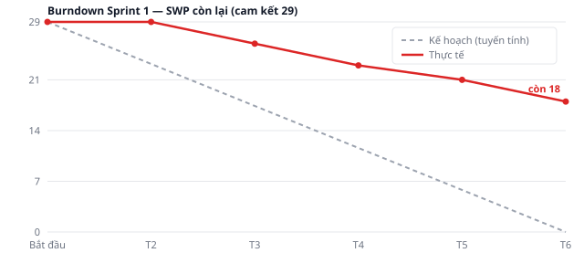

# progress-report.md — Báo cáo tiến độ Sprint 1

**Iteration trên Project:** `Sprint 1`
**Khoảng thời gian giả lập:** 02/11/2026 – 08/11/2026 (1 tuần, 5 ngày làm việc)
**Nguồn số liệu:** [GitHub Project #2](https://github.com/users/oNguyenVanManh/projects/2) — trường `Status`, `SWP`, `Giờ ước lượng`, `Sprint`

> Đây là sprint **giả lập**. Trạng thái issue được cập nhật như sau một sprint chạy thật để minh hoạ
> cách báo cáo, không phải tiến độ của một đội đang làm việc.

---

## 1. Phạm vi Sprint 1

Sprint 1 lấy các hạng mục **pha Requirement**, đúng bằng sức chứa một tuần của đội khởi động
(2 BrSE, 1 PM, 1 BE, 1 Design — chưa có FE, Native, QA, Infra vào việc).

| Issue | SWP | Giờ | Trạng thái cuối sprint |
|---|--:|--:|---|
| [#318](https://github.com/oNguyenVanManh/product-a-backlog/issues/318) [PRJ-01·BrSE 1/3] Phân tích yêu cầu chi tiết + ma trận tru | 3 | 12 | **Done** |
| [#319](https://github.com/oNguyenVanManh/product-a-backlog/issues/319) [PRJ-01·BrSE 2/3] Phân tích yêu cầu chi tiết + ma trận tru | 3 | 12 | **In Review** |
| [#320](https://github.com/oNguyenVanManh/product-a-backlog/issues/320) [PRJ-01·BE] Phân tích yêu cầu chi tiết + ma trận truy vết  | 2 | 8 | **Done** |
| [#321](https://github.com/oNguyenVanManh/product-a-backlog/issues/321) [PRJ-02·BrSE 1/2] Mô tả luồng nghiệp vụ mục tiêu TO-BE | 3 | 12 | **In Progress** |
| [#322](https://github.com/oNguyenVanManh/product-a-backlog/issues/322) [PRJ-02·BrSE 2/2] Mô tả luồng nghiệp vụ mục tiêu TO-BE | 3 | 12 | **Todo** |
| [#323](https://github.com/oNguyenVanManh/product-a-backlog/issues/323) [PRJ-02·Design] Mô tả luồng nghiệp vụ mục tiêu TO-BE | 3 | 12 | **Blocked** |
| [#324](https://github.com/oNguyenVanManh/product-a-backlog/issues/324) [PRJ-03·PM] Chốt 20 tiền đề và nhật ký làm rõ yêu cầu với  | 3 | 12 | **Done** |
| [#325](https://github.com/oNguyenVanManh/product-a-backlog/issues/325) [PRJ-03·BrSE 1/2] Chốt 20 tiền đề và nhật ký làm rõ yêu cầ | 3 | 12 | **Done** |
| [#507](https://github.com/oNguyenVanManh/product-a-backlog/issues/507) [PRJ-01·BrSE 3/3] Phân tích yêu cầu chi tiết + ma trận tru | 6 | 24 | **Todo** |
| **Tổng cam kết** | **29** | **116** | |

Sức chứa BrSE tuần này là 2 người × 40 h = 80 h, mà riêng phần BrSE trong sprint đã là 84 h. **Sprint
bị cam kết vượt sức chứa ngay từ đầu** — đó là lý do hai issue cuối không ai động tới, xem mục 4.

**Hai mươi issue quản trị theo tháng ([#452] PM, [#462] BrSE) cố tình KHÔNG xếp vào sprint nào.**
Chúng trải theo lịch cả tháng (112 h và 80 h mỗi issue); nhét vào một iteration 1 tuần sẽ làm burndown
sai hẳn. Cùng lý do với ngoại lệ cap 3 MD ở [`task-breakdown.md`](./task-breakdown.md) §1 và quy tắc B
ở [`estimate.md`](./estimate.md) §2.

---

## 2. Trạng thái cuối sprint

| Trạng thái | Số issue | Tổng SWP | Ghi chú |
|---|--:|--:|---|
| Done | 4 | 11 | Đạt định nghĩa xong |
| In Review | 1 | 3 | Viết xong, chờ khách xác nhận |
| In Progress | 1 | 3 | Bắt đầu muộn, chưa xong |
| Blocked | 1 | 3 | Bị chặn, xem mục 4 |
| Todo | 2 | 9 | **Không ai động tới** — sprint cam kết vượt sức chứa |
| **Tổng** | **9** | **29** | hoàn thành **11/29 = 37.9 %** |

---

## 3. Burndown

| Mốc | Kế hoạch (SWP còn lại) | Thực tế | Lệch | Việc đóng trong ngày |
|---|--:|--:|--:|---|
| Bắt đầu | 29,0 | 29 | 0 | — |
| Hết T2 | 23,2 | 29 | +5,8 | chưa đóng gì — ngày họp khởi động |
| Hết T3 | 17,4 | 26 | +8,6 | #324 chốt 20 tiền đề (3) |
| Hết T4 | 11,6 | 23 | +11,4 | #325 nhật ký làm rõ (3) |
| Hết T5 | 5,8 | 21 | +15,2 | #320 ma trận truy vết (2) |
| Hết T6 | 0,0 | 18 | +18,0 | #318 phân tích yêu cầu 1/3 (3) |

**Thực tế lệch kế hoạch ở đâu.** Hai nguyên nhân tách bạch:

1. **Cam kết vượt sức chứa.** Phần BrSE là 84 h trên sức chứa 80 h, chưa kể BrSE còn phải trả lời
   câu hỏi phát sinh từ khách. Hai issue [#322] và [#507] không ai chạm tới — chúng lẽ ra không nên
   được đưa vào sprint.
2. **Phụ thuộc chặn việc.** [#323] Design bị chặn bởi [#319] đang chờ khách duyệt. Đây đúng loại phụ
   thuộc mà [`task-breakdown.md`](./task-breakdown.md) §4 mô tả: Design chờ BrSE.

Đường thực tế nằm ngang suốt ngày đầu vì không issue nào đủ nhỏ để đóng trong một ngày. Sau khi hạ
cap xuống 3 MD, issue lớn nhất sprint này là 6 SWP ≈ 1,5 ngày — vẫn chưa đủ nhỏ để có tín hiệu sớm
trong sprint 1 tuần.

**Rút ra cho Sprint 2:** cam kết tối đa **24 SWP** thay vì 29, và không nhận issue mới cho tới khi
[#319], [#321], [#323] đóng.

---

## 4. Rủi ro trễ

| Rủi ro | Issue | Ảnh hưởng tới mốc nào | Hành động | Ai làm, khi nào |
|---|---|---|---|---|
| **Khách chưa xác nhận luồng TO-BE** nên wireframe không khởi động được | [#323](https://github.com/oNguyenVanManh/product-a-backlog/issues/323) ← [#319](https://github.com/oNguyenVanManh/product-a-backlog/issues/319) | Cổng duyệt Basic Design ([#326](https://github.com/oNguyenVanManh/product-a-backlog/issues/326) PRJ-09), dự kiến cuối tháng 11 | Đặt lịch họp xác nhận luồng TO-BE trong 3 ngày đầu Sprint 2; chưa duyệt kịp thì Design bám bản nháp và ghi rõ là giả định | BrSE đặt lịch, chậm nhất 05/11/2026 |
| **Sprint cam kết vượt sức chứa BrSE** (84 h trên 80 h) nên 9 SWP không được chạm | [#322](https://github.com/oNguyenVanManh/product-a-backlog/issues/322), [#507](https://github.com/oNguyenVanManh/product-a-backlog/issues/507) | Mốc kết thúc Requirement | Giảm cam kết Sprint 2 xuống 24 SWP; chuyển hai issue này lên đầu Sprint 2 | PM, buổi lập kế hoạch Sprint 2 |
| **Pha Requirement là pha nặng nhất** (71 MD theo LAB-1). Sprint 1 chỉ đạt 38 % nên phần hụt dồn sang sau | [#319](https://github.com/oNguyenVanManh/product-a-backlog/issues/319), [#321](https://github.com/oNguyenVanManh/product-a-backlog/issues/321), [#322](https://github.com/oNguyenVanManh/product-a-backlog/issues/322) | Mốc kết thúc Requirement | Không nhận việc mới vào Sprint 2 cho tới khi ba issue này đóng | PM, đầu Sprint 2 |
| **完納奨励金 chưa được khách chốt chi tiết.** Quy tắc tra tỷ lệ theo ngày nghiệp vụ và cách ghi bút toán điều chỉnh mới là giả định của ta | [#7](https://github.com/oNguyenVanManh/product-a-backlog/issues/7) EP-07 | Toàn bộ EP-07; làm lại thì mất tới 90 SWP ≈ 360 h | Đưa câu hỏi vào nhật ký làm rõ ([#324](https://github.com/oNguyenVanManh/product-a-backlog/issues/324)) và **chặn mọi issue EP-07 khỏi Sprint 2–5** cho tới khi có trả lời bằng văn bản | BrSE gửi câu hỏi trong Sprint 2 |
| **業務日 02:00–10:00 JST và 休市日 chưa có lịch thật của chợ.** Thiếu lịch thì không kiểm được trigger khoá ngày | [#98](https://github.com/oNguyenVanManh/product-a-backlog/issues/98) PRJ-16 | Khung ứng dụng và mọi test liên quan khoá sổ | Xin lịch chợ 12 tháng gần nhất làm dữ liệu mẫu | BrSE, trong Sprint 2 |
| **`SCR_20_SPEC.md` tự mâu thuẫn** về việc kết quả tính thưởng có được ghi đè hay không — phát hiện khi viết điều kiện nghiệm thu | [#7](https://github.com/oNguyenVanManh/product-a-backlog/issues/7) EP-07 | Thiết kế CSDL phần thưởng | Gửi khách hỏi dứt điểm trước khi code EP-07; ghi ở [`task-breakdown.md`](./task-breakdown.md) §5.2 | BrSE, Sprint 2 |

> **Ghi chú đọc board:** bốn issue chưa xong của Sprint 1 ([#319], [#321], [#322], [#323]) vẫn giữ
> nguyên `Sprint 1` trên Project để giữ đúng lịch sử cam kết và để burndown ở trên khớp với board.
> Việc chuyển chúng sang Sprint 2 diễn ra ở buổi lập kế hoạch Sprint 2. Sprint 2–12 trên board hiện
> chứa **việc mới**, chưa gồm phần tồn này.
