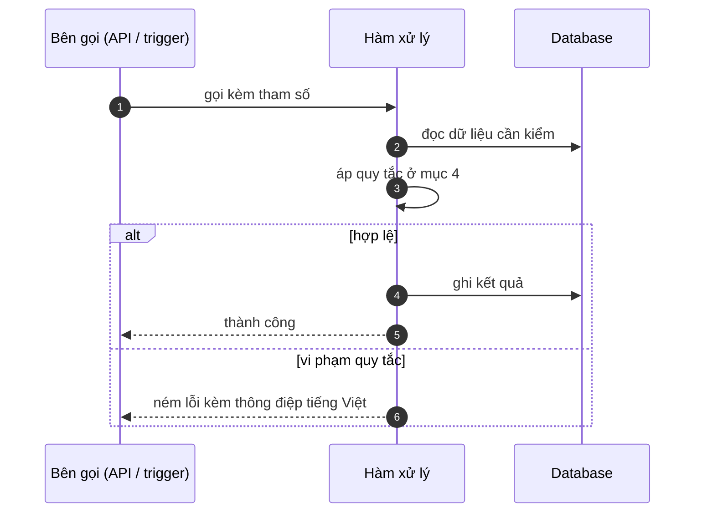

# FNC_056 — Sinh file đối soát kế toán

> Biểu mẫu: **BM-2-901-53 v1.1** — Technical Design · SUN ASTERISK VIETNAM CO., LTD · ISO/IEC 27001:2013 & ISO 9001:2015

> **Bổ sung sau phản hồi LAB-4.** Chức năng này trước đó chỉ có một dòng tên trong tài liệu
> yêu cầu. Trục P (phủ và truy vết phạm vi) bị trừ điểm vì vậy.

---

## 1. History of change

| No | Version | Action | Nội dung thay đổi | Ngày | Người sửa |
|---|---|---|---|---|---|
| 1 | 0.1.0 | Add New | Viết spec cho chức năng nền FNC-056 theo phản hồi LAB-4 | 2026-10-24 | nguyen-van-manh-c |

---

## 2. Sequence diagram

---

## 3. Description

**Loại:** Logic

**Cơ chế kích hoạt:** Kích hoạt sau khi khoá sổ một ngày nghiệp vụ, hoặc gọi tay từ màn SCR-28.

**Dữ liệu:** Đọc: `trade` (đã xác nhận), `delivery`, `settlement_day`. Ghi: tệp CSV tạm + `accounting_export`.

---

## 4. Detail function

### 4.1.

| Mục | Nội dung |
|---|---|
| Quy tắc | Chỉ sinh cho ngày **đã khoá sổ** — IF-ACC-01 |

### 4.2.

| Mục | Nội dung |
|---|---|
| Quy tắc | 6 trường tối thiểu: ngày nghiệp vụ · mã bên tham gia · tổng tiền · thuế · trạng thái · mã lô xuất |

### 4.3.

| Mục | Nội dung |
|---|---|
| Quy tắc | Chỉ cộng giao dịch `confirm_status = 'confirmed'` |

### 4.4.

| Mục | Nội dung |
|---|---|
| Quy tắc | Tên tệp `SETTLE_YYYYMMDD.csv`, mã hoá UTF-8 |

### 4.5.

| Mục | Nội dung |
|---|---|
| Quy tắc | Sinh lại cùng ngày được nhưng **bắt buộc ghi lý do** |

---

## 5. Other Notes

**Xử lý lỗi**

- Ngày chưa khoá sổ → từ chối, nêu rõ ngày nào còn mở
- Không có giao dịch nào → vẫn sinh tệp rỗng có header, để bên kế toán biết đã chạy

**Tham chiếu**

- Mã thông điệp: [`_common/error-codes.md`](../../_common/error-codes.md)
- Quy ước nhật ký: [`_common/log-convention.md`](../../_common/log-convention.md)
