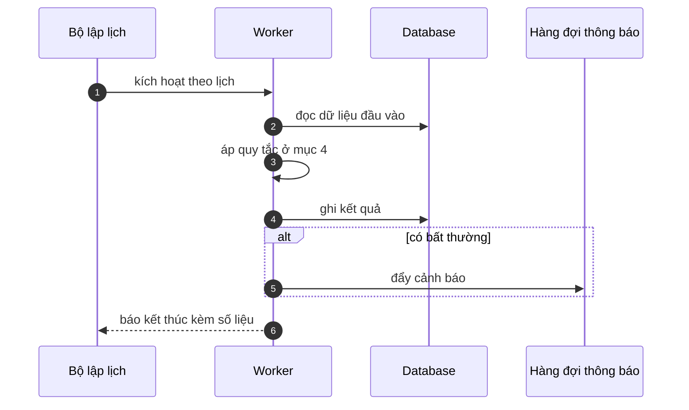

# FNC_057 — Batch phát hành file lên SFTP

> Biểu mẫu: **BM-2-901-53 v1.1** — Technical Design · SUN ASTERISK VIETNAM CO., LTD · ISO/IEC 27001:2013 & ISO 9001:2015

> **Bổ sung sau phản hồi LAB-4.** Chức năng này trước đó chỉ có một dòng tên trong tài liệu
> yêu cầu. Trục P (phủ và truy vết phạm vi) bị trừ điểm vì vậy.

---

## 1. History of change

| No | Version | Action | Nội dung thay đổi | Ngày | Người sửa |
|---|---|---|---|---|---|
| 1 | 0.1.0 | Add New | Viết spec cho chức năng nền FNC-057 theo phản hồi LAB-4 | 2026-10-24 | nguyen-van-manh-c |

---

## 2. Sequence diagram

---

## 3. Description

**Loại:** Batch

**Cơ chế kích hoạt:** Lịch chạy **mỗi ngày 10:45 JST**, sau khi FNC-056 sinh tệp.

**Dữ liệu:** Đọc: tệp từ S3 + `accounting_export`. Ghi: trạng thái phát hành, số lần thử.

---

## 4. Detail function

### 4.1.

| Mục | Nội dung |
|---|---|
| Quy tắc | Đẩy lên thư mục SFTP do khách cấp, **một chiều** — hệ thống không đọc ngược lại |

### 4.2.

| Mục | Nội dung |
|---|---|
| Quy tắc | Thử lại tối đa 3 lần, cách nhau 15 phút |

### 4.3.

| Mục | Nội dung |
|---|---|
| Quy tắc | Xác nhận bằng cách đọc lại kích thước tệp trên máy chủ đích |

### 4.4.

| Mục | Nội dung |
|---|---|
| Quy tắc | Phương thức kết nối vẫn là **giả định ASM-14**, khách chưa xác nhận — nếu đổi sang API thì phát sinh thêm tài liệu API và xử lý lỗi |

---

## 5. Other Notes

**Xử lý lỗi**

- Thất bại hết 3 lần → cảnh báo mức Khẩn cho `ROLE_SETTLEMENT`
- Kích thước tệp đích khác nguồn → coi là thất bại, đẩy lại

**Tham chiếu**

- Mã thông điệp: [`_common/error-codes.md`](../../_common/error-codes.md)
- Quy ước nhật ký: [`_common/log-convention.md`](../../_common/log-convention.md)
