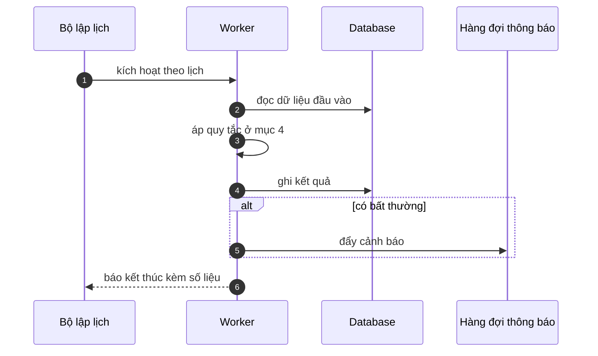

# FNC_050 — Job chuyển ảnh sang lưu trữ lạnh

> Biểu mẫu: **BM-2-901-53 v1.1** — Technical Design · SUN ASTERISK VIETNAM CO., LTD · ISO/IEC 27001:2013 & ISO 9001:2015

> **Bổ sung sau phản hồi LAB-4.** Chức năng này trước đó chỉ có một dòng tên trong tài liệu
> yêu cầu. Trục P (phủ và truy vết phạm vi) bị trừ điểm vì vậy.

---

## 1. History of change

| No | Version | Action | Nội dung thay đổi | Ngày | Người sửa |
|---|---|---|---|---|---|
| 1 | 0.1.0 | Add New | Viết spec cho chức năng nền FNC-050 theo phản hồi LAB-4 | 2026-10-24 | nguyen-van-manh-c |

---

## 2. Sequence diagram

---

## 3. Description

**Loại:** Job

**Cơ chế kích hoạt:** Lịch chạy **Chủ nhật hàng tuần, 12:00 JST** — ngày chợ nghỉ.

**Dữ liệu:** Đọc/ghi: metadata ảnh trong database; chuyển lớp lưu trữ S3 → Glacier.

---

## 4. Detail function

### 4.1.

| Mục | Nội dung |
|---|---|
| Quy tắc | Ảnh cũ hơn **3 năm** chuyển sang lưu trữ lạnh (NFR-RET-01) |

### 4.2.

| Mục | Nội dung |
|---|---|
| Quy tắc | Dữ liệu nghiệp vụ giữ **7 năm** trực tuyến — khác chu kỳ với ảnh |

### 4.3.

| Mục | Nội dung |
|---|---|
| Quy tắc | Chuyển lớp lưu trữ, **không xoá**; đường dẫn không đổi nên liên kết cũ vẫn sống |

### 4.4.

| Mục | Nội dung |
|---|---|
| Quy tắc | Ảnh thuộc tranh chấp chưa đóng thì **không** chuyển, bất kể tuổi |

---

## 5. Other Notes

**Xử lý lỗi**

- Chuyển thất bại → giữ nguyên ở lớp nóng, thử lại tuần sau
- Không bao giờ xoá ảnh trong job này — xoá là thao tác thủ công có phê duyệt

**Tham chiếu**

- Mã thông điệp: [`_common/error-codes.md`](../../_common/error-codes.md)
- Quy ước nhật ký: [`_common/log-convention.md`](../../_common/log-convention.md)
