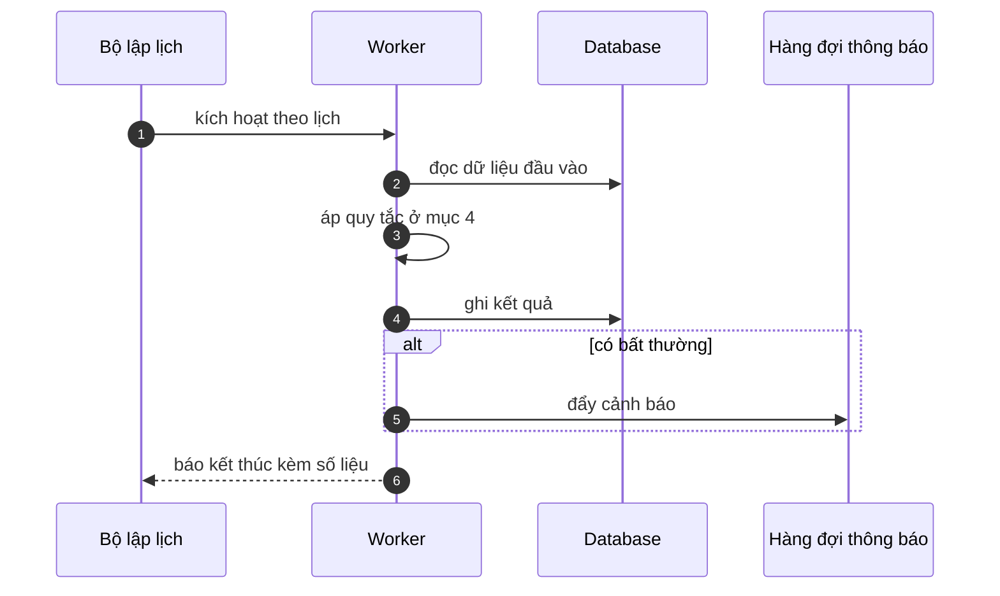

# FNC_051 — Job kiểm tra chất lượng dữ liệu

> Biểu mẫu: **BM-2-901-53 v1.1** — Technical Design · SUN ASTERISK VIETNAM CO., LTD · ISO/IEC 27001:2013 & ISO 9001:2015

> **Bổ sung sau phản hồi LAB-4.** Chức năng này trước đó chỉ có một dòng tên trong tài liệu
> yêu cầu. Trục P (phủ và truy vết phạm vi) bị trừ điểm vì vậy.

---

## 1. History of change

| No | Version | Action | Nội dung thay đổi | Ngày | Người sửa |
|---|---|---|---|---|---|
| 1 | 0.1.0 | Add New | Viết spec cho chức năng nền FNC-051 theo phản hồi LAB-4 | 2026-10-24 | nguyen-van-manh-c |

---

## 2. Sequence diagram

---

## 3. Description

**Loại:** Job

**Cơ chế kích hoạt:** Lịch chạy **mỗi ngày 11:30 JST**, sau khi báo cáo xong.

**Dữ liệu:** Đọc: toàn bộ bảng nghiệp vụ. Ghi: `data_quality_finding`, hàng đợi thông báo quản trị.

---

## 4. Detail function

### 4.1.

| Mục | Nội dung |
|---|---|
| Quy tắc | Kiểm 6 bất thường: `remaining_kg` âm · giao dịch mồ côi không có lô · dòng đảo trỏ sai · `paid_date` trước `business_day` · tư cách sai cặp vai trò · `audit_log` có khoảng trống thời gian |

### 4.2.

| Mục | Nội dung |
|---|---|
| Quy tắc | Chỉ **phát hiện và báo**, không tự sửa dữ liệu |

### 4.3.

| Mục | Nội dung |
|---|---|
| Quy tắc | Mỗi phát hiện ghi kèm câu truy vấn tái lập được, để người xử lý kiểm lại |

---

## 5. Other Notes

**Xử lý lỗi**

- Job lỗi giữa chừng → ghi các phát hiện đã tìm được, không bỏ hết

**Tham chiếu**

- Mã thông điệp: [`_common/error-codes.md`](../../_common/error-codes.md)
- Quy ước nhật ký: [`_common/log-convention.md`](../../_common/log-convention.md)
