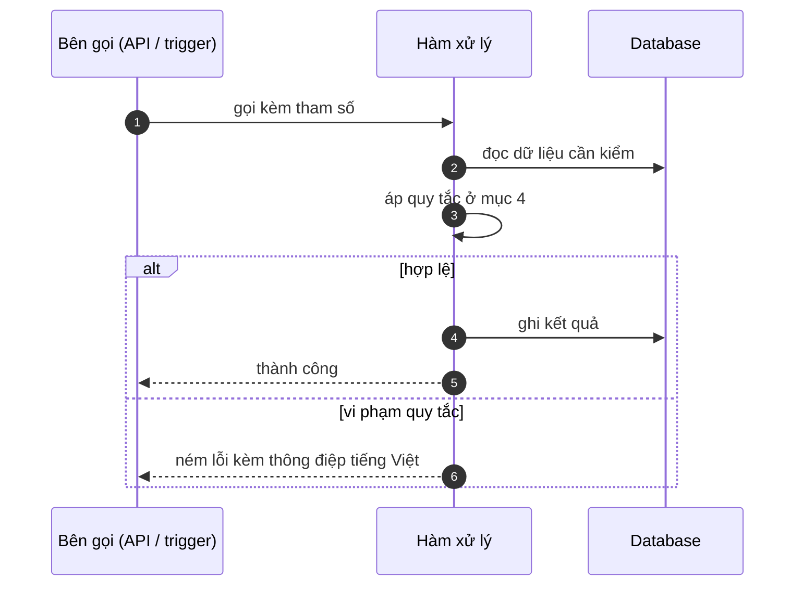

# FNC_009 — Quản lý phiên và hết hạn phiên

> Biểu mẫu: **BM-2-901-53 v1.1** — Technical Design · SUN ASTERISK VIETNAM CO., LTD · ISO/IEC 27001:2013 & ISO 9001:2015

> **Bổ sung sau phản hồi LAB-4.** Chức năng này trước đó chỉ có một dòng tên trong tài liệu
> yêu cầu. Trục P (phủ và truy vết phạm vi) bị trừ điểm vì vậy.

---

## 1. History of change

| No | Version | Action | Nội dung thay đổi | Ngày | Người sửa |
|---|---|---|---|---|---|
| 1 | 0.1.0 | Add New | Viết spec cho chức năng nền FNC-009 theo phản hồi LAB-4 | 2026-10-24 | nguyen-van-manh-c |

---

## 2. Sequence diagram

---

## 3. Description

**Loại:** Logic

**Cơ chế kích hoạt:** Mỗi request đi qua `getSession()`; không có lịch chạy riêng.

**Dữ liệu:** Đọc: cookie `pa_session` (payload + chữ ký HMAC-SHA256). Không chạm database.

---

## 4. Detail function

### 4.1.

| Mục | Nội dung |
|---|---|
| Quy tắc | Phiên sống 8 tiếng kể từ lúc đăng nhập — xấp xỉ một ca chợ 02:00–10:00 JST |

### 4.2.

| Mục | Nội dung |
|---|---|
| Quy tắc | Xác minh chữ ký bằng so sánh thời gian hằng định, không dùng `==` |

### 4.3.

| Mục | Nội dung |
|---|---|
| Quy tắc | Chữ ký sai hoặc hết hạn → trả `null`, **không** tự gia hạn |

### 4.4.

| Mục | Nội dung |
|---|---|
| Quy tắc | Không có cơ chế refresh token: hết hạn thì đăng nhập lại |

---

## 5. Other Notes

**Xử lý lỗi**

- Chữ ký không khớp → coi như chưa đăng nhập, HTTP 401 `M_40`
- Cookie hỏng định dạng → `null`, không ném lỗi ra ngoài

**Tham chiếu**

- Mã thông điệp: [`_common/error-codes.md`](../../_common/error-codes.md)
- Quy ước nhật ký: [`_common/log-convention.md`](../../_common/log-convention.md)
