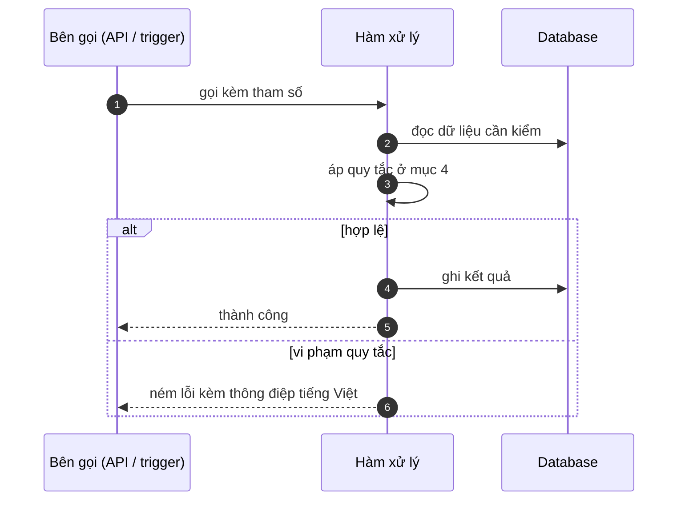

# FNC_010 — Khoá tạm khi sai nhiều lần và ghi log bất thường

> Biểu mẫu: **BM-2-901-53 v1.1** — Technical Design · SUN ASTERISK VIETNAM CO., LTD · ISO/IEC 27001:2013 & ISO 9001:2015

> **Bổ sung sau phản hồi LAB-4.** Chức năng này trước đó chỉ có một dòng tên trong tài liệu
> yêu cầu. Trục P (phủ và truy vết phạm vi) bị trừ điểm vì vậy.

---

## 1. History of change

| No | Version | Action | Nội dung thay đổi | Ngày | Người sửa |
|---|---|---|---|---|---|
| 1 | 0.1.0 | Add New | Viết spec cho chức năng nền FNC-010 theo phản hồi LAB-4 | 2026-10-24 | nguyen-van-manh-c |

---

## 2. Sequence diagram

---

## 3. Description

**Loại:** Logic

**Cơ chế kích hoạt:** Kích hoạt trong `POST /api/auth/login` mỗi lần xác thực thất bại.

**Dữ liệu:** Đọc/ghi: bảng `login_attempt` (email, ip, attempted_at, success). Ghi `audit_log` khi khoá.

---

## 4. Detail function

### 4.1.

| Mục | Nội dung |
|---|---|
| Quy tắc | Đếm số lần thất bại trong **15 phút gần nhất**, theo cặp (email, ip) |

### 4.2.

| Mục | Nội dung |
|---|---|
| Quy tắc | Chạm **5 lần** → khoá tạm **15 phút**, trả lỗi chung chung không tiết lộ lý do khoá |

### 4.3.

| Mục | Nội dung |
|---|---|
| Quy tắc | Đăng nhập thành công → xoá bộ đếm của cặp đó |

### 4.4.

| Mục | Nội dung |
|---|---|
| Quy tắc | Khoá tạm **không** làm `app_user.is_active` thành false — đó là thao tác của quản trị |

### 4.5.

| Mục | Nội dung |
|---|---|
| Quy tắc | Mỗi lần khoá ghi `audit_log` action = `LOGIN_LOCKED` |

---

## 5. Other Notes

**Xử lý lỗi**

- Bảng `login_attempt` không ghi được → **vẫn cho đăng nhập**, ghi cảnh báo vận hành. Không để lỗi hạ tầng chặn người dùng hợp lệ

**Tham chiếu**

- Mã thông điệp: [`_common/error-codes.md`](../../_common/error-codes.md)
- Quy ước nhật ký: [`_common/log-convention.md`](../../_common/log-convention.md)
