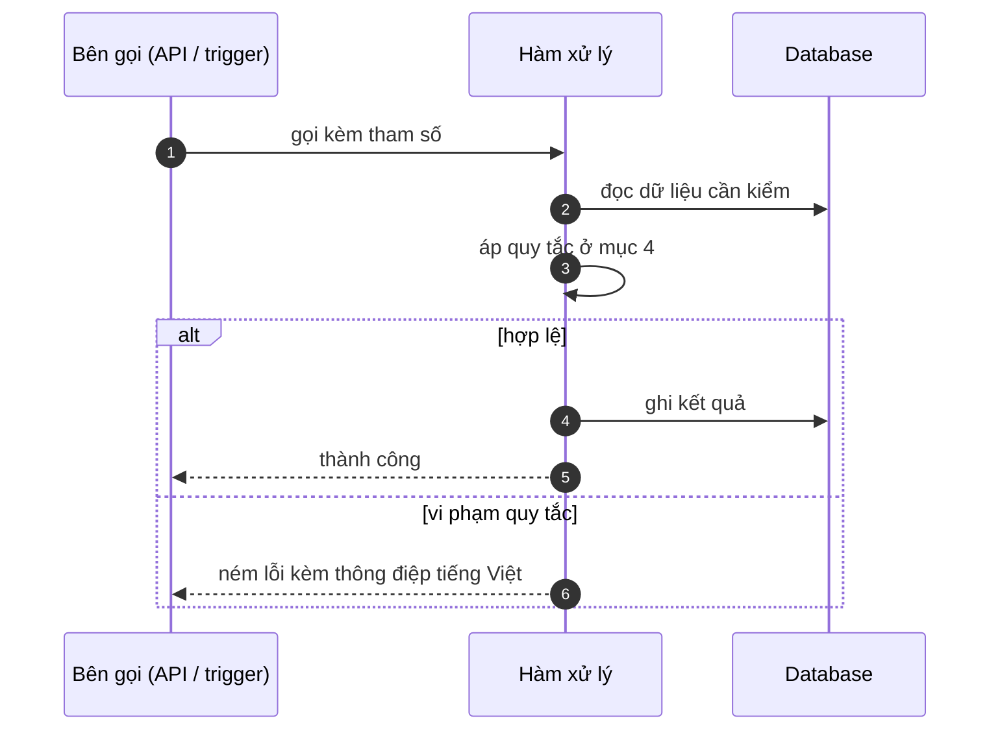

# FNC_012 — Kiểm tra quyền theo vai trò ở mọi thao tác

> Biểu mẫu: **BM-2-901-53 v1.1** — Technical Design · SUN ASTERISK VIETNAM CO., LTD · ISO/IEC 27001:2013 & ISO 9001:2015

> **Bổ sung sau phản hồi LAB-4.** Chức năng này trước đó chỉ có một dòng tên trong tài liệu
> yêu cầu. Trục P (phủ và truy vết phạm vi) bị trừ điểm vì vậy.

---

## 1. History of change

| No | Version | Action | Nội dung thay đổi | Ngày | Người sửa |
|---|---|---|---|---|---|
| 1 | 0.1.0 | Add New | Viết spec cho chức năng nền FNC-012 theo phản hồi LAB-4 | 2026-10-24 | nguyen-van-manh-c |

---

## 2. Sequence diagram

---

## 3. Description

**Loại:** Logic

**Cơ chế kích hoạt:** Gọi ở đầu mỗi API route, sau `getSession()`, trước khi chạm database.

**Dữ liệu:** Đọc: `session.role`. Không truy vấn thêm.

---

## 4. Detail function

### 4.1.

| Mục | Nội dung |
|---|---|
| Quy tắc | Ma trận quyền là **một bảng hằng số trong mã nguồn**, không phải cấu hình trong database — đổi quyền phải qua review mã |

### 4.2.

| Mục | Nội dung |
|---|---|
| Quy tắc | Mặc định **từ chối**: thao tác không có trong ma trận thì chặn |

### 4.3.

| Mục | Nội dung |
|---|---|
| Quy tắc | Kiểm ở tầng API **không thay thế** trigger ở database — hai lớp độc lập |

### 4.4.

| Mục | Nội dung |
|---|---|
| Quy tắc | `ROLE_SYS_ADMIN` không tự động có mọi quyền nghiệp vụ; chỉ có quyền quản trị |

---

## 5. Other Notes

**Xử lý lỗi**

- Vai trò không đủ → HTTP 403 `M_41` kèm tên thao tác bị từ chối
- Session hợp lệ nhưng vai trò không nằm trong 6 giá trị → 403, ghi `audit_log`

**Tham chiếu**

- Mã thông điệp: [`_common/error-codes.md`](../../_common/error-codes.md)
- Quy ước nhật ký: [`_common/log-convention.md`](../../_common/log-convention.md)
