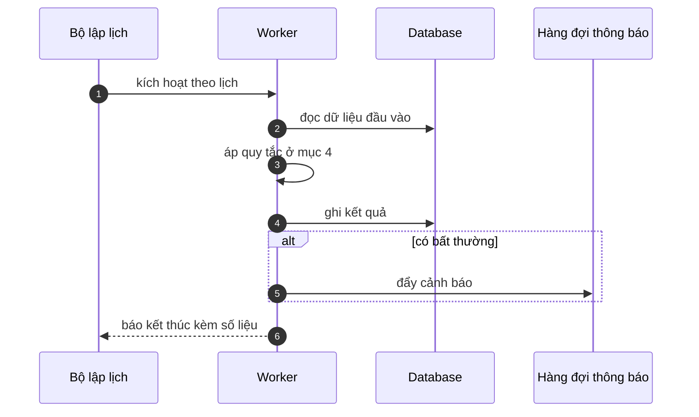

# FNC_013 — Job dọn phiên hết hạn

> Biểu mẫu: **BM-2-901-53 v1.1** — Technical Design · SUN ASTERISK VIETNAM CO., LTD · ISO/IEC 27001:2013 & ISO 9001:2015

> **Bổ sung sau phản hồi LAB-4.** Chức năng này trước đó chỉ có một dòng tên trong tài liệu
> yêu cầu. Trục P (phủ và truy vết phạm vi) bị trừ điểm vì vậy.

---

## 1. History of change

| No | Version | Action | Nội dung thay đổi | Ngày | Người sửa |
|---|---|---|---|---|---|
| 1 | 0.1.0 | Add New | Viết spec cho chức năng nền FNC-013 theo phản hồi LAB-4 | 2026-10-24 | nguyen-van-manh-c |

---

## 2. Sequence diagram

---

## 3. Description

**Loại:** Job

**Cơ chế kích hoạt:** Lịch chạy **mỗi ngày 11:00 JST**, sau khi hết khung dịch vụ. EventBridge Scheduler kích hoạt worker.

**Dữ liệu:** Xoá: bản ghi `login_attempt` cũ hơn 30 ngày. Ghi: `audit_log` số dòng đã xoá.

---

## 4. Detail function

### 4.1.

| Mục | Nội dung |
|---|---|
| Quy tắc | Phiên lưu ở cookie phía trình duyệt nên **không có bảng session để dọn** — job này chỉ dọn bộ đếm đăng nhập |

### 4.2.

| Mục | Nội dung |
|---|---|
| Quy tắc | Giữ 30 ngày để phục vụ điều tra sự cố bảo mật |

### 4.3.

| Mục | Nội dung |
|---|---|
| Quy tắc | Xoá theo lô 1.000 dòng, không khoá bảng lâu |

---

## 5. Other Notes

**Xử lý lỗi**

- Job thất bại → thử lại tối đa 3 lần, cách nhau 10 phút. Vẫn thất bại thì đưa vào hàng đợi cảnh báo vận hành
- Job chạy chồng → bỏ qua lượt sau, ghi log

**Tham chiếu**

- Mã thông điệp: [`_common/error-codes.md`](../../_common/error-codes.md)
- Quy ước nhật ký: [`_common/log-convention.md`](../../_common/log-convention.md)
