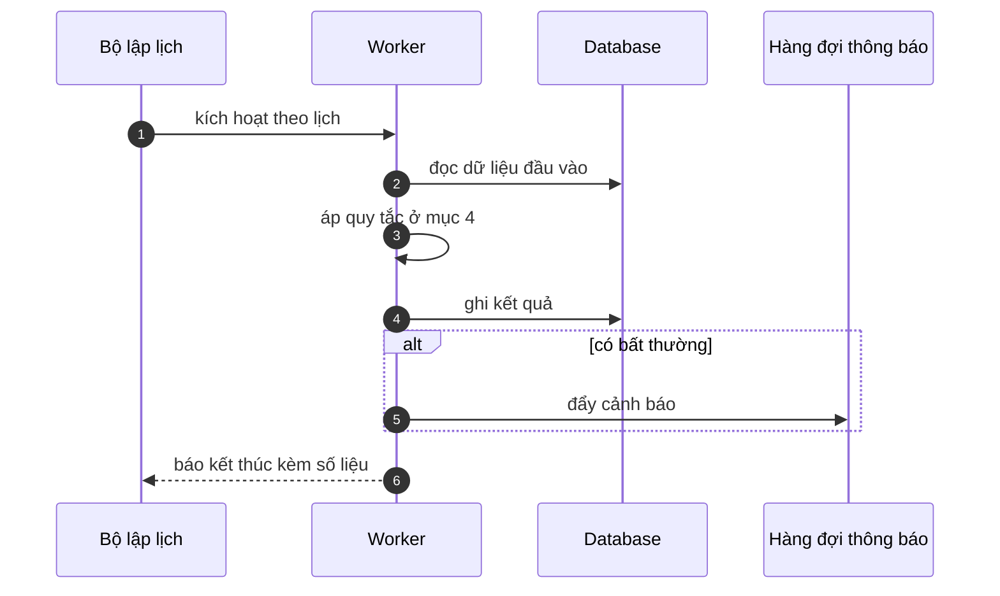

# FNC_028 — Job phát hiện giao hàng tồn đọng

> Biểu mẫu: **BM-2-901-53 v1.1** — Technical Design · SUN ASTERISK VIETNAM CO., LTD · ISO/IEC 27001:2013 & ISO 9001:2015

> **Bổ sung sau phản hồi LAB-4.** Chức năng này trước đó chỉ có một dòng tên trong tài liệu
> yêu cầu. Trục P (phủ và truy vết phạm vi) bị trừ điểm vì vậy.

---

## 1. History of change

| No | Version | Action | Nội dung thay đổi | Ngày | Người sửa |
|---|---|---|---|---|---|
| 1 | 0.1.0 | Add New | Viết spec cho chức năng nền FNC-028 theo phản hồi LAB-4 | 2026-10-24 | nguyen-van-manh-c |

---

## 2. Sequence diagram

---

## 3. Description

**Loại:** Job

**Cơ chế kích hoạt:** Lịch chạy **mỗi ngày 10:30 JST**, ngay sau khung dịch vụ.

**Dữ liệu:** Đọc: `trade` ⋈ `delivery`. Ghi: hàng đợi thông báo cho `ROLE_DELIVERY`.

---

## 4. Detail function

### 4.1.

| Mục | Nội dung |
|---|---|
| Quy tắc | Tồn đọng = giao dịch đã chốt **quá 2 ngày nghiệp vụ** mà tổng đã giao < khối lượng hợp đồng |

### 4.2.

| Mục | Nội dung |
|---|---|
| Quy tắc | Bỏ qua giao dịch đã bị đảo hết (khối lượng ròng ≤ 0) |

### 4.3.

| Mục | Nội dung |
|---|---|
| Quy tắc | Ngày nghỉ chợ (休市日) không tính vào số ngày tồn đọng |

### 4.4.

| Mục | Nội dung |
|---|---|
| Quy tắc | Mỗi giao dịch chỉ cảnh báo **một lần**, trừ khi quá 5 ngày thì nhắc lại |

---

## 5. Other Notes

**Xử lý lỗi**

- Không gửi được thông báo → ghi vào hàng đợi thử lại (FNC-054), không bỏ im lặng

**Tham chiếu**

- Mã thông điệp: [`_common/error-codes.md`](../../_common/error-codes.md)
- Quy ước nhật ký: [`_common/log-convention.md`](../../_common/log-convention.md)
