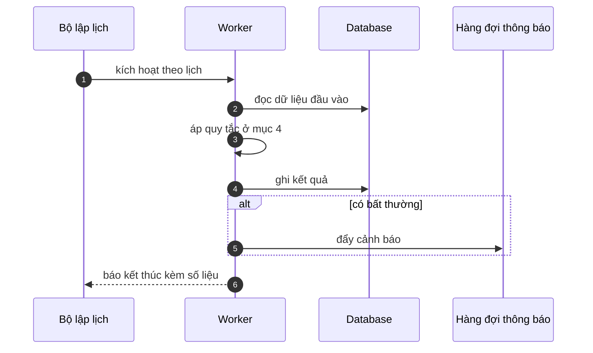

# FNC_037 — Batch tính thưởng cuối kỳ

> Biểu mẫu: **BM-2-901-53 v1.1** — Technical Design · SUN ASTERISK VIETNAM CO., LTD · ISO/IEC 27001:2013 & ISO 9001:2015

> **Bổ sung sau phản hồi LAB-4.** Chức năng này trước đó chỉ có một dòng tên trong tài liệu
> yêu cầu. Trục P (phủ và truy vết phạm vi) bị trừ điểm vì vậy.

---

## 1. History of change

| No | Version | Action | Nội dung thay đổi | Ngày | Người sửa |
|---|---|---|---|---|---|
| 1 | 0.1.0 | Add New | Viết spec cho chức năng nền FNC-037 theo phản hồi LAB-4 | 2026-10-24 | nguyen-van-manh-c |

---

## 2. Sequence diagram

---

## 3. Description

**Loại:** Batch

**Cơ chế kích hoạt:** Lịch chạy **ngày 1 hàng tháng, 11:00 JST**, tính cho tháng vừa kết thúc.

**Dữ liệu:** Đọc: `trade` (đã xác nhận), `payment_status`, `rate_version`. Ghi: `incentive` với `entry_type = 'original'`.

---

## 4. Detail function

### 4.1.

| Mục | Nội dung |
|---|---|
| Quy tắc | Chỉ tính cho ngày nghiệp vụ **đã khoá sổ** — ngày còn mở thì bỏ qua và cảnh báo |

### 4.2.

| Mục | Nội dung |
|---|---|
| Quy tắc | Chỉ cộng giao dịch có `confirm_status = 'confirmed'` (ADR-009) |

### 4.3.

| Mục | Nội dung |
|---|---|
| Quy tắc | Tra biểu suất bằng `rate_as_of(business_day)` — **không** lấy bản mới nhất (GOV-RULE-01) |

### 4.4.

| Mục | Nội dung |
|---|---|
| Quy tắc | Làm tròn **xuống** đơn vị JPY sau khi nhân hệ số thuế 110/100 (BR-INC-01) |

### 4.5.

| Mục | Nội dung |
|---|---|
| Quy tắc | Chạy lại cùng một kỳ **không ghi đè**: sinh dòng `adjustment` nếu lệch (FNC-038) |

---

## 5. Other Notes

**Xử lý lỗi**

- Kỳ có ngày chưa khoá sổ → dừng, báo danh sách ngày còn mở
- Chưa có biểu suất hiệu lực → HTTP 409 `M_50`, không tính bừa

**Tham chiếu**

- Mã thông điệp: [`_common/error-codes.md`](../../_common/error-codes.md)
- Quy ước nhật ký: [`_common/log-convention.md`](../../_common/log-convention.md)
