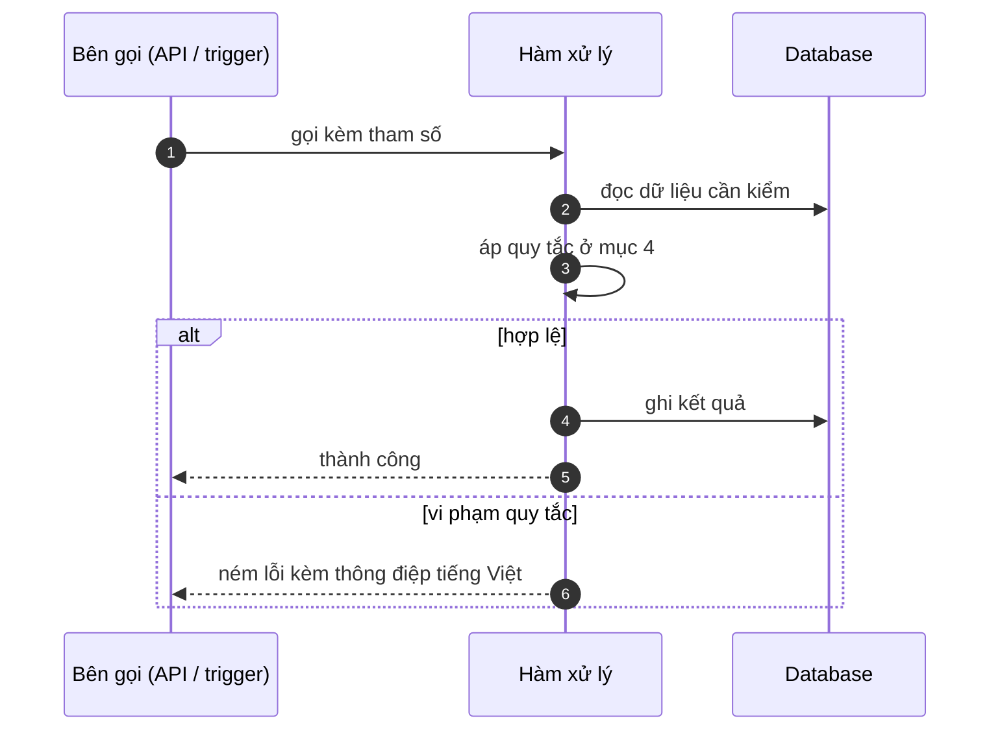

# FNC_038 — Sinh chênh lệch thưởng kỳ sau

> Biểu mẫu: **BM-2-901-53 v1.1** — Technical Design · SUN ASTERISK VIETNAM CO., LTD · ISO/IEC 27001:2013 & ISO 9001:2015

> **Bổ sung sau phản hồi LAB-4.** Chức năng này trước đó chỉ có một dòng tên trong tài liệu
> yêu cầu. Trục P (phủ và truy vết phạm vi) bị trừ điểm vì vậy.

---

## 1. History of change

| No | Version | Action | Nội dung thay đổi | Ngày | Người sửa |
|---|---|---|---|---|---|
| 1 | 0.1.0 | Add New | Viết spec cho chức năng nền FNC-038 theo phản hồi LAB-4 | 2026-10-24 | nguyen-van-manh-c |

---

## 2. Sequence diagram

---

## 3. Description

**Loại:** Logic

**Cơ chế kích hoạt:** Kích hoạt khi batch FNC-037 chạy lại một kỳ đã có kết quả, hoặc khi đối soát phát hiện sai số.

**Dữ liệu:** Đọc: `incentive` dòng `original` của kỳ đó. Ghi: dòng mới `entry_type = 'adjustment'`.

---

## 4. Detail function

### 4.1.

| Mục | Nội dung |
|---|---|
| Quy tắc | **Không sửa dòng gốc.** Ghi dòng mới mang số chênh — dương hoặc âm (FR-INC-03) |

### 4.2.

| Mục | Nội dung |
|---|---|
| Quy tắc | `adjusts_id` trỏ về dòng gốc; `posted_period` là kỳ **sau**, không bao giờ là kỳ gốc |

### 4.3.

| Mục | Nội dung |
|---|---|
| Quy tắc | Số tiền thực trả một kỳ = tổng mọi dòng có `posted_period` thuộc kỳ đó |

### 4.4.

| Mục | Nội dung |
|---|---|
| Quy tắc | Chênh lệch bằng 0 thì **không** ghi dòng nào |

### 4.5.

| Mục | Nội dung |
|---|---|
| Quy tắc | Cùng tinh thần sổ ghi-thêm của bảng `trade` (ADR-001) |

---

## 5. Other Notes

**Xử lý lỗi**

- Dòng gốc không tồn tại → dừng, không tạo dòng mồ côi
- Kỳ sau đã khoá sổ → đẩy sang kỳ kế tiếp còn mở, ghi log lý do

**Tham chiếu**

- Mã thông điệp: [`_common/error-codes.md`](../../_common/error-codes.md)
- Quy ước nhật ký: [`_common/log-convention.md`](../../_common/log-convention.md)
