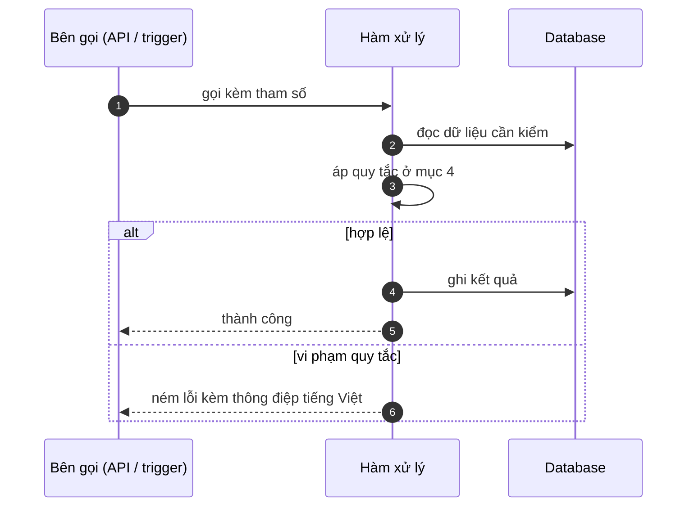

# FNC_016 — Kiểm tra và trừ số lượng khả dụng

> Biểu mẫu: **BM-2-901-53 v1.1** — Technical Design · SUN ASTERISK VIETNAM CO., LTD · ISO/IEC 27001:2013 & ISO 9001:2015

> **Bổ sung sau phản hồi LAB-4.** Chức năng này trước đó chỉ có một dòng tên trong tài liệu
> yêu cầu. Trục P (phủ và truy vết phạm vi) bị trừ điểm vì vậy.

---

## 1. History of change

| No | Version | Action | Nội dung thay đổi | Ngày | Người sửa |
|---|---|---|---|---|---|
| 1 | 0.1.0 | Add New | Viết spec cho chức năng nền FNC-016 theo phản hồi LAB-4 | 2026-10-24 | nguyen-van-manh-c |

---

## 2. Sequence diagram

---

## 3. Description

**Loại:** Logic

**Cơ chế kích hoạt:** Kích hoạt trong giao dịch database khi ghi một dòng `trade` mới.

**Dữ liệu:** Đọc/ghi: `lot.remaining_kg`. Cùng transaction với `INSERT trade`.

---

## 4. Detail function

### 4.1.

| Mục | Nội dung |
|---|---|
| Quy tắc | `quantity_kg` không được vượt `lot.remaining_kg` tại thời điểm chốt |

### 4.2.

| Mục | Nội dung |
|---|---|
| Quy tắc | Trừ và ghi giao dịch nằm **cùng một transaction** — hai người chốt cùng lúc trên một lô không thể cùng thành công |

### 4.3.

| Mục | Nội dung |
|---|---|
| Quy tắc | Dòng đảo **cộng trả** khối lượng về cho lô |

### 4.4.

| Mục | Nội dung |
|---|---|
| Quy tắc | `remaining_kg` không bao giờ âm — cần CHECK ở database (hiện còn thiếu, xem R-03) |

---

## 5. Other Notes

**Xử lý lỗi**

- Vượt số còn lại → HTTP 409 `M_20` kèm số kg còn lại thật
- Xung đột đồng thời → một bên nhận lỗi, không có chuyện cả hai cùng ghi

**Tham chiếu**

- Mã thông điệp: [`_common/error-codes.md`](../../_common/error-codes.md)
- Quy ước nhật ký: [`_common/log-convention.md`](../../_common/log-convention.md)
