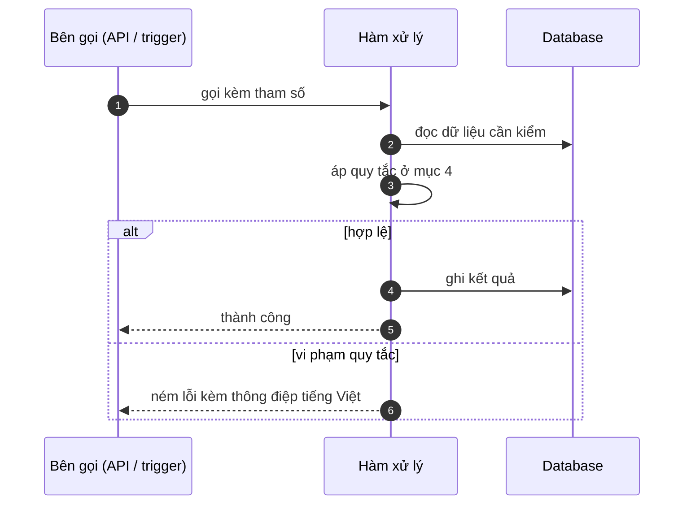

# FNC_061 — Hàng đợi offline trên thiết bị

> Biểu mẫu: **BM-2-901-53 v1.1** — Technical Design · SUN ASTERISK VIETNAM CO., LTD · ISO/IEC 27001:2013 & ISO 9001:2015

> **Bổ sung sau phản hồi LAB-4.** Chức năng này trước đó chỉ có một dòng tên trong tài liệu
> yêu cầu. Trục P (phủ và truy vết phạm vi) bị trừ điểm vì vậy.

---

## 1. History of change

| No | Version | Action | Nội dung thay đổi | Ngày | Người sửa |
|---|---|---|---|---|---|
| 1 | 0.1.0 | Add New | Viết spec cho chức năng nền FNC-061 theo phản hồi LAB-4 | 2026-10-24 | nguyen-van-manh-c |

---

## 2. Sequence diagram

---

## 3. Description

**Loại:** Logic

**Cơ chế kích hoạt:** Kích hoạt khi thiết bị mất kết nối trong lúc tiếp nhận lô hoặc ghi giao hàng (NFR-AVL-02).

**Dữ liệu:** Ghi: IndexedDB trên thiết bị. Đồng bộ lên server khi có mạng.

---

## 4. Detail function

### 4.1.

| Mục | Nội dung |
|---|---|
| Quy tắc | Chỉ **hai thao tác** được phép offline: tiếp nhận lô và ghi giao hàng. Chốt giao dịch **không** — nó cần kiểm tư cách và tồn lô theo thời gian thực |

### 4.2.

| Mục | Nội dung |
|---|---|
| Quy tắc | Hàng đợi giữ tối đa **15 phút** dữ liệu; quá thì cảnh báo người dùng dừng nhập |

### 4.3.

| Mục | Nội dung |
|---|---|
| Quy tắc | Mỗi mục có mã định danh sinh ở thiết bị để chống ghi trùng khi đồng bộ lại |

### 4.4.

| Mục | Nội dung |
|---|---|
| Quy tắc | Dữ liệu trong hàng đợi **mã hoá**, xoá sau khi đồng bộ thành công |

### 4.5.

| Mục | Nội dung |
|---|---|
| Quy tắc | ⚠️ **Chưa triển khai** ở prototype LAB-3 — nợ kỹ thuật N-04, phụ thuộc quyết định có làm native hay không (ADR-008) |

---

## 5. Other Notes

**Xử lý lỗi**

- Đồng bộ xung đột → chuyển sang FNC-062, không tự ghi đè
- Hàng đợi đầy → chặn nhập mới, hiện cảnh báo rõ ràng

**Tham chiếu**

- Mã thông điệp: [`_common/error-codes.md`](../../_common/error-codes.md)
- Quy ước nhật ký: [`_common/log-convention.md`](../../_common/log-convention.md)
