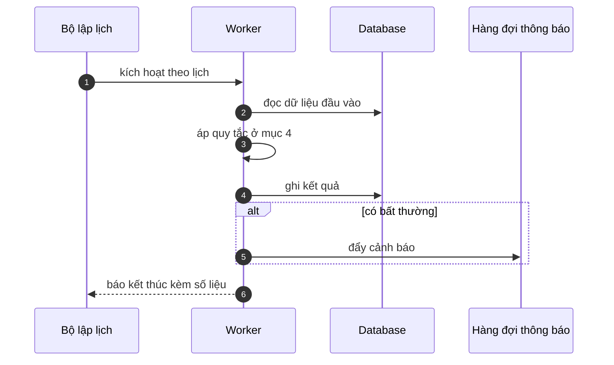

# FNC_062 — Job đồng bộ và hoà giải xung đột

> Biểu mẫu: **BM-2-901-53 v1.1** — Technical Design · SUN ASTERISK VIETNAM CO., LTD · ISO/IEC 27001:2013 & ISO 9001:2015

> **Bổ sung sau phản hồi LAB-4.** Chức năng này trước đó chỉ có một dòng tên trong tài liệu
> yêu cầu. Trục P (phủ và truy vết phạm vi) bị trừ điểm vì vậy.

---

## 1. History of change

| No | Version | Action | Nội dung thay đổi | Ngày | Người sửa |
|---|---|---|---|---|---|
| 1 | 0.1.0 | Add New | Viết spec cho chức năng nền FNC-062 theo phản hồi LAB-4 | 2026-10-24 | nguyen-van-manh-c |

---

## 2. Sequence diagram

---

## 3. Description

**Loại:** Job

**Cơ chế kích hoạt:** Kích hoạt khi thiết bị khôi phục kết nối; chạy ở phía server khi nhận lô dữ liệu offline.

**Dữ liệu:** Đọc/ghi: bảng nghiệp vụ tương ứng + `sync_conflict`.

---

## 4. Detail function

### 4.1.

| Mục | Nội dung |
|---|---|
| Quy tắc | Thứ tự áp dụng theo **thời điểm ghi ở thiết bị**, không phải thời điểm server nhận |

### 4.2.

| Mục | Nội dung |
|---|---|
| Quy tắc | Mã định danh trùng → bỏ qua, coi như đã ghi (idempotent) |

### 4.3.

| Mục | Nội dung |
|---|---|
| Quy tắc | Ngày nghiệp vụ đã khoá sổ trong lúc thiết bị offline → **từ chối**, đưa vào `sync_conflict` cho người xử lý tay |

### 4.4.

| Mục | Nội dung |
|---|---|
| Quy tắc | Không bao giờ tự ghi đè dữ liệu đã có trên server |

---

## 5. Other Notes

**Xử lý lỗi**

- Xung đột không tự giải được → ghi `sync_conflict`, thông báo `ROLE_SYS_ADMIN`, giữ nguyên cả hai bản

**Tham chiếu**

- Mã thông điệp: [`_common/error-codes.md`](../../_common/error-codes.md)
- Quy ước nhật ký: [`_common/log-convention.md`](../../_common/log-convention.md)
