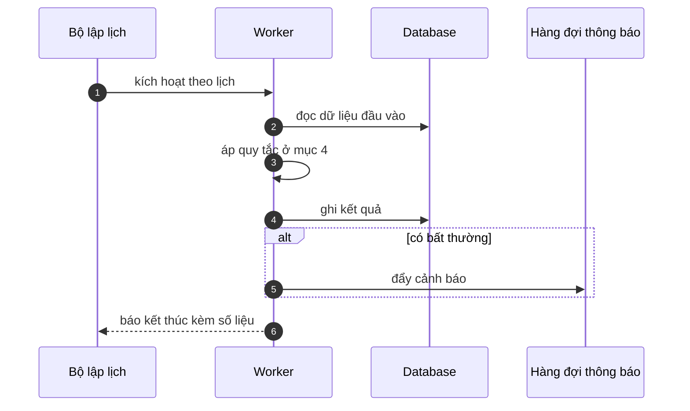

# FNC_063 — Đồng bộ danh mục xuống thiết bị

> Biểu mẫu: **BM-2-901-53 v1.1** — Technical Design · SUN ASTERISK VIETNAM CO., LTD · ISO/IEC 27001:2013 & ISO 9001:2015

> **Bổ sung sau phản hồi LAB-4.** Chức năng này trước đó chỉ có một dòng tên trong tài liệu
> yêu cầu. Trục P (phủ và truy vết phạm vi) bị trừ điểm vì vậy.

---

## 1. History of change

| No | Version | Action | Nội dung thay đổi | Ngày | Người sửa |
|---|---|---|---|---|---|
| 1 | 0.1.0 | Add New | Viết spec cho chức năng nền FNC-063 theo phản hồi LAB-4 | 2026-10-24 | nguyen-van-manh-c |

---

## 2. Sequence diagram

---

## 3. Description

**Loại:** Job

**Cơ chế kích hoạt:** Kích hoạt khi thiết bị đăng nhập, và mỗi 4 tiếng khi đang online.

**Dữ liệu:** Đọc: danh mục loài thuỷ sản, lịch chợ, tham số hệ thống, danh sách bên tham gia còn hiệu lực.

---

## 4. Detail function

### 4.1.

| Mục | Nội dung |
|---|---|
| Quy tắc | Chỉ tải **phần thay đổi** kể từ lần đồng bộ trước, theo dấu thời gian |

### 4.2.

| Mục | Nội dung |
|---|---|
| Quy tắc | Danh mục ở thiết bị là bản **chỉ đọc** — mọi thay đổi chỉ từ server xuống |

### 4.3.

| Mục | Nội dung |
|---|---|
| Quy tắc | Danh sách bên tham gia chỉ gồm bên **còn tư cách hợp lệ** tại thời điểm đồng bộ |

### 4.4.

| Mục | Nội dung |
|---|---|
| Quy tắc | Thiết bị không đồng bộ quá **24 tiếng** thì chặn thao tác offline, bắt kết nối lại |

---

## 5. Other Notes

**Xử lý lỗi**

- Đồng bộ lỗi → giữ danh mục cũ, hiện cảnh báo tuổi dữ liệu trên màn hình

**Tham chiếu**

- Mã thông điệp: [`_common/error-codes.md`](../../_common/error-codes.md)
- Quy ước nhật ký: [`_common/log-convention.md`](../../_common/log-convention.md)
