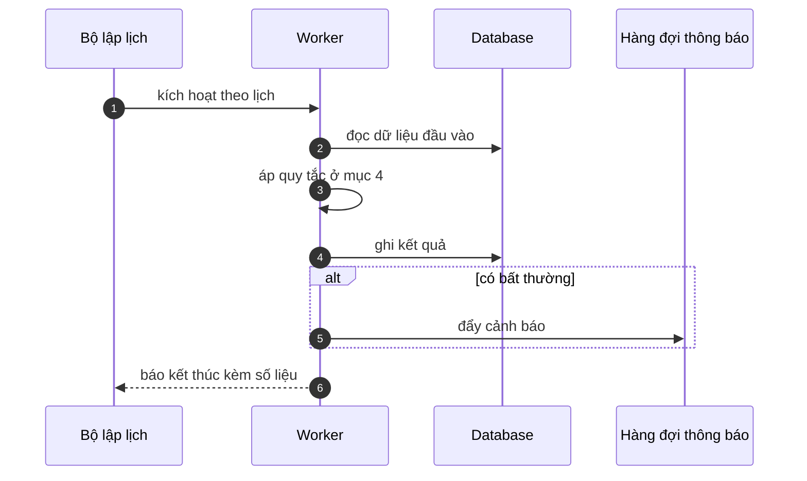

# FNC_053 — Bộ điều phối gửi thông báo

> Biểu mẫu: **BM-2-901-53 v1.1** — Technical Design · SUN ASTERISK VIETNAM CO., LTD · ISO/IEC 27001:2013 & ISO 9001:2015

> **Bổ sung sau phản hồi LAB-4.** Chức năng này trước đó chỉ có một dòng tên trong tài liệu
> yêu cầu. Trục P (phủ và truy vết phạm vi) bị trừ điểm vì vậy.

---

## 1. History of change

| No | Version | Action | Nội dung thay đổi | Ngày | Người sửa |
|---|---|---|---|---|---|
| 1 | 0.1.0 | Add New | Viết spec cho chức năng nền FNC-053 theo phản hồi LAB-4 | 2026-10-24 | nguyen-van-manh-c |

---

## 2. Sequence diagram

---

## 3. Description

**Loại:** Job

**Cơ chế kích hoạt:** Chạy liên tục, quét hàng đợi **mỗi 60 giây**.

**Dữ liệu:** Đọc/ghi: `notification_queue` (trạng thái, số lần thử, thời điểm thử kế tiếp).

---

## 4. Detail function

### 4.1.

| Mục | Nội dung |
|---|---|
| Quy tắc | Hai kênh: trong ứng dụng và email. **Không dùng SMS hay FAX** (BR-NOTIFY-01) |

### 4.2.

| Mục | Nội dung |
|---|---|
| Quy tắc | Thông báo mức **Khẩn** phải gửi trong vòng 5 phút kể từ lúc vào hàng đợi |

### 4.3.

| Mục | Nội dung |
|---|---|
| Quy tắc | Gộp thông báo cùng loại cùng người nhận trong 10 phút thành một email |

### 4.4.

| Mục | Nội dung |
|---|---|
| Quy tắc | Người nhận xác định theo **vai trò**, không theo cá nhân — đổi nhân sự không phải sửa cấu hình |

---

## 5. Other Notes

**Xử lý lỗi**

- Gửi thất bại → chuyển sang FNC-054 để thử lại, không bỏ im lặng
- Hàng đợi vượt 1.000 mục chưa gửi → cảnh báo vận hành

**Tham chiếu**

- Mã thông điệp: [`_common/error-codes.md`](../../_common/error-codes.md)
- Quy ước nhật ký: [`_common/log-convention.md`](../../_common/log-convention.md)
