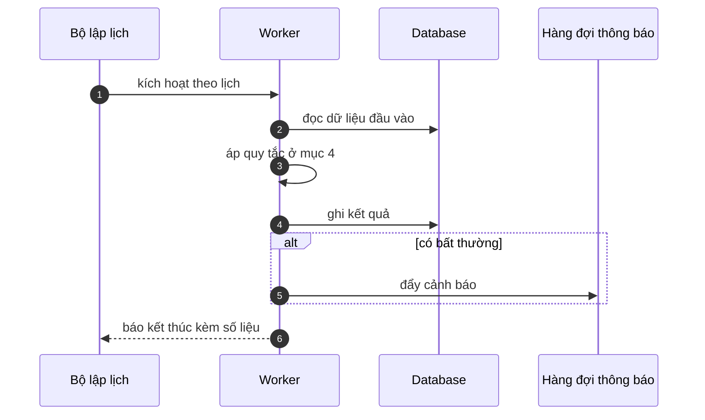

# FNC_054 — Job thử lại gửi email thất bại

> Biểu mẫu: **BM-2-901-53 v1.1** — Technical Design · SUN ASTERISK VIETNAM CO., LTD · ISO/IEC 27001:2013 & ISO 9001:2015

> **Bổ sung sau phản hồi LAB-4.** Chức năng này trước đó chỉ có một dòng tên trong tài liệu
> yêu cầu. Trục P (phủ và truy vết phạm vi) bị trừ điểm vì vậy.

---

## 1. History of change

| No | Version | Action | Nội dung thay đổi | Ngày | Người sửa |
|---|---|---|---|---|---|
| 1 | 0.1.0 | Add New | Viết spec cho chức năng nền FNC-054 theo phản hồi LAB-4 | 2026-10-24 | nguyen-van-manh-c |

---

## 2. Sequence diagram

---

## 3. Description

**Loại:** Job

**Cơ chế kích hoạt:** Lịch chạy **mỗi 5 phút**, chỉ xử lý mục có trạng thái `failed`.

**Dữ liệu:** Đọc/ghi: `notification_queue`.

---

## 4. Detail function

### 4.1.

| Mục | Nội dung |
|---|---|
| Quy tắc | Thử lại tối đa **3 lần**, giãn cách luỹ tiến: 5 phút → 15 phút → 60 phút |

### 4.2.

| Mục | Nội dung |
|---|---|
| Quy tắc | Hết 3 lần → chuyển trạng thái `dead`, đẩy vào hàng đợi cảnh báo vận hành |

### 4.3.

| Mục | Nội dung |
|---|---|
| Quy tắc | Lỗi địa chỉ email không tồn tại (5xx) → **không** thử lại, chuyển `dead` ngay |

### 4.4.

| Mục | Nội dung |
|---|---|
| Quy tắc | Lỗi tạm thời (4xx, timeout) mới thử lại |

---

## 5. Other Notes

**Xử lý lỗi**

- Mục `dead` không bao giờ tự xoá — giữ để điều tra, dọn thủ công

**Tham chiếu**

- Mã thông điệp: [`_common/error-codes.md`](../../_common/error-codes.md)
- Quy ước nhật ký: [`_common/log-convention.md`](../../_common/log-convention.md)
