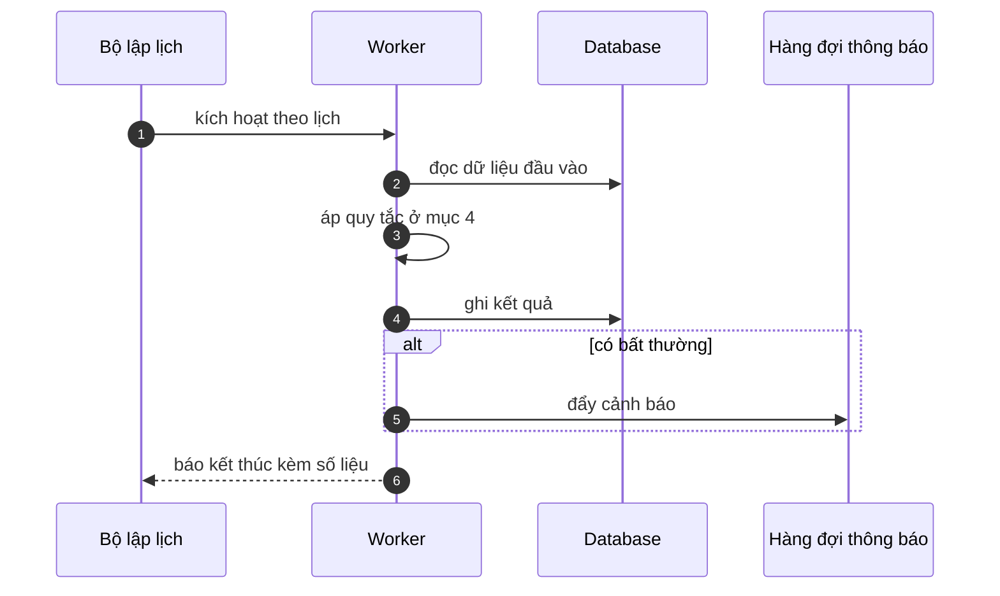

# FNC_047 — Batch sinh báo cáo ngày

> Biểu mẫu: **BM-2-901-53 v1.1** — Technical Design · SUN ASTERISK VIETNAM CO., LTD · ISO/IEC 27001:2013 & ISO 9001:2015

> **Bổ sung sau phản hồi LAB-4.** Chức năng này trước đó chỉ có một dòng tên trong tài liệu
> yêu cầu. Trục P (phủ và truy vết phạm vi) bị trừ điểm vì vậy.

---

## 1. History of change

| No | Version | Action | Nội dung thay đổi | Ngày | Người sửa |
|---|---|---|---|---|---|
| 1 | 0.1.0 | Add New | Viết spec cho chức năng nền FNC-047 theo phản hồi LAB-4 | 2026-10-24 | nguyen-van-manh-c |

---

## 2. Sequence diagram

---

## 3. Description

**Loại:** Batch

**Cơ chế kích hoạt:** Lịch chạy **mỗi ngày 10:15 JST**, sau khi khoá sổ. Phải xong trước **11:00 JST** (NFR-BATCH-01).

**Dữ liệu:** Đọc: toàn bộ bảng nghiệp vụ của ngày. Ghi: tệp CSV vào S3, bản ghi vào `report_run`.

---

## 4. Detail function

### 4.1.

| Mục | Nội dung |
|---|---|
| Quy tắc | Chỉ chạy cho ngày **đã khoá sổ** — dữ liệu chưa chốt thì báo cáo vô nghĩa |

### 4.2.

| Mục | Nội dung |
|---|---|
| Quy tắc | Sinh 9 báo cáo ngày RPT-01..09 trong một lượt, dùng chung một ảnh chụp dữ liệu |

### 4.3.

| Mục | Nội dung |
|---|---|
| Quy tắc | Mỗi tệp có tên `RPT-XX_YYYYMMDD.csv`, mã hoá UTF-8 có BOM để Excel tiếng Nhật đọc đúng |

### 4.4.

| Mục | Nội dung |
|---|---|
| Quy tắc | Chạy lại cùng ngày → ghi đè tệp cũ, nhưng `report_run` giữ cả hai lần chạy |

---

## 5. Other Notes

**Xử lý lỗi**

- Quá 11:00 JST chưa xong → cảnh báo vận hành ngay, không chờ tới lúc kết thúc
- Một báo cáo lỗi → các báo cáo còn lại **vẫn chạy**, ghi riêng trạng thái từng tệp

**Tham chiếu**

- Mã thông điệp: [`_common/error-codes.md`](../../_common/error-codes.md)
- Quy ước nhật ký: [`_common/log-convention.md`](../../_common/log-convention.md)
