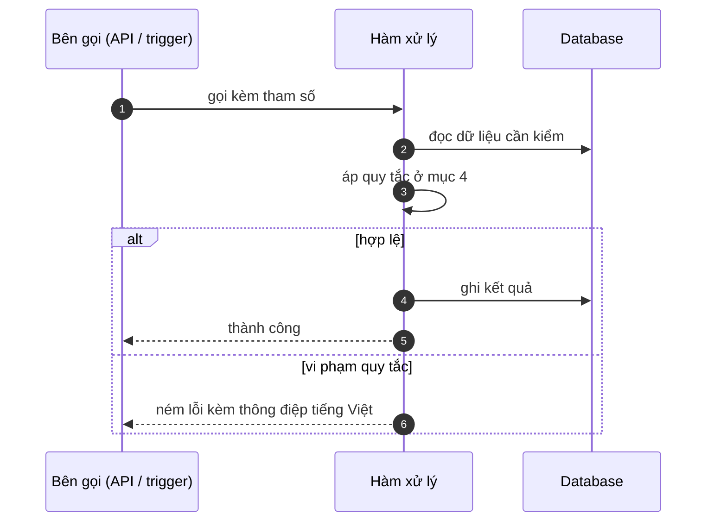

# FNC_042 — Tra cứu quy định theo ngày nghiệp vụ

> Biểu mẫu: **BM-2-901-53 v1.1** — Technical Design · SUN ASTERISK VIETNAM CO., LTD · ISO/IEC 27001:2013 & ISO 9001:2015

> **Bổ sung sau phản hồi LAB-4.** Chức năng này trước đó chỉ có một dòng tên trong tài liệu
> yêu cầu. Trục P (phủ và truy vết phạm vi) bị trừ điểm vì vậy.

---

## 1. History of change

| No | Version | Action | Nội dung thay đổi | Ngày | Người sửa |
|---|---|---|---|---|---|
| 1 | 0.1.0 | Add New | Viết spec cho chức năng nền FNC-042 theo phản hồi LAB-4 | 2026-10-24 | nguyen-van-manh-c |

---

## 2. Sequence diagram

---

## 3. Description

**Loại:** Logic

**Cơ chế kích hoạt:** Hàm `rate_as_of(ngày)` trong PostgreSQL; gọi từ batch tính thưởng và từ API.

**Dữ liệu:** Đọc: `rate_version`. Không ghi.

---

## 4. Detail function

### 4.1.

| Mục | Nội dung |
|---|---|
| Quy tắc | Lấy phiên bản có `effective_from <= ngày nghiệp vụ`, sắp xếp giảm dần, lấy **một** bản |

### 4.2.

| Mục | Nội dung |
|---|---|
| Quy tắc | **Không** lấy bản mới nhất — đây là khác biệt duy nhất giữa đúng và sai của cả khối thưởng |

### 4.3.

| Mục | Nội dung |
|---|---|
| Quy tắc | Số phiên bản đã dùng lưu vào `incentive.rate_version_no` để tái lập con số khi bị chất vấn |

### 4.4.

| Mục | Nội dung |
|---|---|
| Quy tắc | Đổi biểu suất hôm nay **không** làm đổi kết quả đã tính của kỳ trước |

---

## 5. Other Notes

**Xử lý lỗi**

- Không có phiên bản nào hiệu lực vào ngày đó → trả `null`, bên gọi phải xử lý, không tự lấy bản gần nhất

**Tham chiếu**

- Mã thông điệp: [`_common/error-codes.md`](../../_common/error-codes.md)
- Quy ước nhật ký: [`_common/log-convention.md`](../../_common/log-convention.md)
