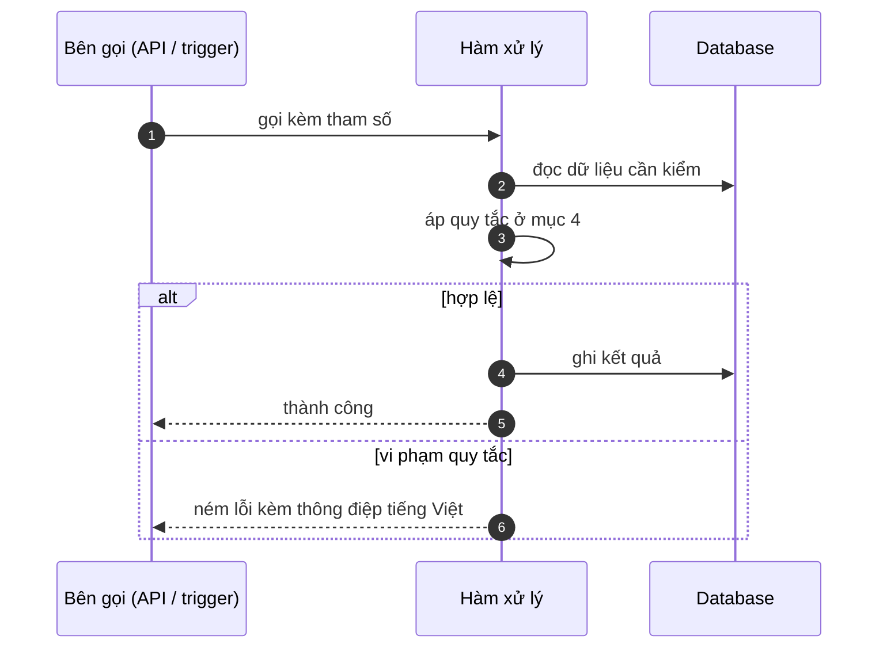

# FNC_031 — Chặn sửa trực tiếp ngày đã khoá

> Biểu mẫu: **BM-2-901-53 v1.1** — Technical Design · SUN ASTERISK VIETNAM CO., LTD · ISO/IEC 27001:2013 & ISO 9001:2015

> **Bổ sung sau phản hồi LAB-4.** Chức năng này trước đó chỉ có một dòng tên trong tài liệu
> yêu cầu. Trục P (phủ và truy vết phạm vi) bị trừ điểm vì vậy.

---

## 1. History of change

| No | Version | Action | Nội dung thay đổi | Ngày | Người sửa |
|---|---|---|---|---|---|
| 1 | 0.1.0 | Add New | Viết spec cho chức năng nền FNC-031 theo phản hồi LAB-4 | 2026-10-24 | nguyen-van-manh-c |

---

## 2. Sequence diagram

---

## 3. Description

**Loại:** Logic

**Cơ chế kích hoạt:** Trigger `BEFORE INSERT` trên `trade` và `delivery` — chạy ở tầng database, không phải tầng ứng dụng.

**Dữ liệu:** Đọc: `settlement_day.is_locked` qua hàm `day_is_locked(business_day)`.

---

## 4. Detail function

### 4.1.

| Mục | Nội dung |
|---|---|
| Quy tắc | Thi hành bằng **trigger PostgreSQL**, nên gọi thẳng API hay chạy SQL trực tiếp đều không lách được |

### 4.2.

| Mục | Nội dung |
|---|---|
| Quy tắc | Chặn cả `INSERT` giao dịch lẫn `INSERT` giao hàng vào ngày đã khoá |

### 4.3.

| Mục | Nội dung |
|---|---|
| Quy tắc | Mở lại ngày được, nhưng ghi `audit_log` action = `UNLOCK_SETTLEMENT_DAY` |

### 4.4.

| Mục | Nội dung |
|---|---|
| Quy tắc | Trigger `trade_no_update` và `trade_no_delete` chặn sửa/xoá **bất kể** ngày đã khoá hay chưa |

---

## 5. Other Notes

**Xử lý lỗi**

- Ghi vào ngày đã khoá → HTTP 409 `M_30`, thông điệp từ trigger trả **nguyên văn** cho người dùng

**Tham chiếu**

- Mã thông điệp: [`_common/error-codes.md`](../../_common/error-codes.md)
- Quy ước nhật ký: [`_common/log-convention.md`](../../_common/log-convention.md)
