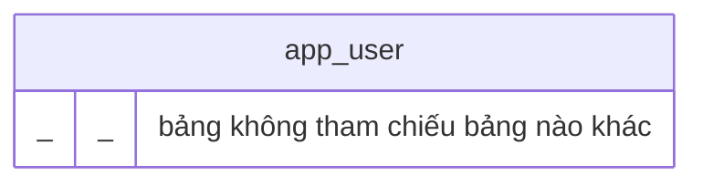

# APP_USER — Người dùng nội bộ (`app_user`)

> Biểu mẫu: **BM-2-901-50 v1.1** — Database Design · SUN ASTERISK VIETNAM CO., LTD · ISO/IEC 27001:2013 & ISO 9001:2015

---

## 1. Lịch sử sửa đổi

| No | Version | Action | Nội dung thay đổi | Ngày | Người sửa |
|---|---|---|---|---|---|
| 1 | 0.1.0 | Add New | Trích từ `supabase/01_schema.sql` của prototype LAB-3 | 2026-10-11 | nguyen-van-manh-c |

---

## 2. Danh sách bảng

| Mục | Giá trị |
|---|---|
| System Name | Hệ thống hỗ trợ vận hành chợ bán buôn thủy sản |
| Schema | `public` |
| Logical table name | Người dùng nội bộ |
| Physics table name | `app_user` |
| CHARACTER SET | UTF-8 |
| Overview | Người dùng nội bộ |

---

## 3. ER Diagram

Quan hệ trực tiếp của `app_user`. Sơ đồ toàn hệ thống ở [`_extra/database-overview.md`](../../../../_extra/database-overview.md).

---
## 4. Định nghĩa bảng

| No. | Key | Logical name | Physic name | Data Type | Not Null | Default | Ghi chú |
|---|---|---|---|---|---|---|---|
| 1 | PK | id | `id` | `uuid` | ✓ | `gen_random_uuid()` |  |
| 2 | UK | email | `email` | `text` | ✓ |  |  |
| 3 |  | full_name | `full_name` | `text` | ✓ |  |  |
| 4 |  | role | `role` | `text` | ✓ |  |  |
| 5 |  | is_active | `is_active` | `boolean` | ✓ | `true` |  |
| 6 |  | created_at | `created_at` | `timestamptz` | ✓ | `now()` |  |

---

### Ràng buộc và ghi chú

`role` có `CHECK` giới hạn đúng **6 giá trị**, khớp với ERD ở `_extra/database-overview.md`:
`ROLE_SYS_ADMIN` · `ROLE_INTAKE` · `ROLE_JUDGE` · `ROLE_TRADE` · `ROLE_DELIVERY` · `ROLE_SETTLEMENT`.

Không có ràng buộc nghiệp vụ đặc biệt ngoài khoá ngoại và CHECK đã nêu ở mục 3.
