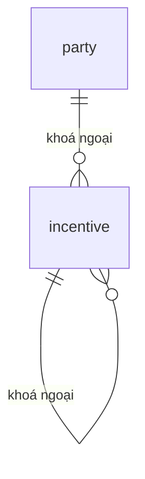

# INCENTIVE — Kết quả tính thưởng (`incentive`)

> Biểu mẫu: **BM-2-901-50 v1.1** — Database Design · SUN ASTERISK VIETNAM CO., LTD · ISO/IEC 27001:2013 & ISO 9001:2015

---

## 1. Lịch sử sửa đổi

| No | Version | Action | Nội dung thay đổi | Ngày | Người sửa |
|---|---|---|---|---|---|
| 1 | 0.1.0 | Add New | Trích từ `supabase/01_schema.sql` của prototype LAB-3 | 2026-10-11 | nguyen-van-manh-c |

---

## 2. Danh sách bảng

| Mục | Giá trị |
|---|---|
| System Name | Hệ thống hỗ trợ vận hành chợ bán buôn thủy sản |
| Schema | `public` |
| Logical table name | Kết quả tính thưởng |
| Physics table name | `incentive` |
| CHARACTER SET | UTF-8 |
| Overview | Kết quả tính thưởng |

---

## 3. ER Diagram

Quan hệ trực tiếp của `incentive`. Sơ đồ toàn hệ thống ở [`_extra/database-overview.md`](../../../../_extra/database-overview.md).

---
## 4. Định nghĩa bảng

| No. | Key | Logical name | Physic name | Data Type | Not Null | Default | Ghi chú |
|---|---|---|---|---|---|---|---|
| 1 | PK | id | `id` | `uuid` | ✓ | `gen_random_uuid()` |  |
| 2 | FK | party_id | `party_id` | `uuid` | ✓ |  | → `party.id` |
| 3 |  | business_day | `business_day` | `date` | ✓ |  |  |
| 4 |  | base_amount | `base_amount` | `numeric(12,2)` | ✓ |  |  |
| 5 |  | rate_version_no | `rate_version_no` | `int` | ✓ |  |  |
| 6 |  | rate_pct | `rate_pct` | `numeric(5,2)` | ✓ |  |  |
| 7 |  | incentive_amt | `incentive_amt` | `numeric(12,2)` | ✓ |  |  |
| 8 |  | on_time | `on_time` | `boolean` | ✓ |  |  |
| 9 |  | calculated_at | `calculated_at` | `timestamptz` | ✓ | `now()` |  |
| 10 |  | unique | `unique` | `(party_id, business_day)` |  |  |  |
| 11 | | Loại bản ghi | `entry_type` | `incentive_entry_type` | ✓ | `'original'` | `original` = tính lần đầu · `adjustment` = chênh lệch kỳ sau |
| 12 | FK | Trỏ về bản gốc | `adjusts_id` | `uuid` |  |  | → `incentive.id`. Khác null = đây là dòng điều chỉnh |
| 13 | | Kỳ ghi nhận chênh lệch | `posted_period` | `date` |  |  | Kỳ mà khoản chênh được tính vào, luôn **sau** `business_day` |

---

### Ràng buộc và ghi chú

**Không ghi đè kết quả đã tính (FR-INC-03).** Nếu sau khi khoá sổ phát hiện cơ sở tính sai, hệ thống **không** sửa dòng gốc. Nó ghi một dòng `entry_type = 'adjustment'` mang số chênh lệch — dương hoặc âm — với `adjusts_id` trỏ về dòng gốc và `posted_period` là kỳ sau. Số tiền thực trả một kỳ là tổng mọi dòng có `posted_period` thuộc kỳ đó.

Cùng tinh thần với sổ ghi-thêm ở bảng `trade` (ADR-001): lịch sử không bao giờ mất, và người kiểm toán tái lập được con số của từng kỳ.

Không có ràng buộc nghiệp vụ đặc biệt ngoài khoá ngoại và CHECK đã nêu ở mục 3.
