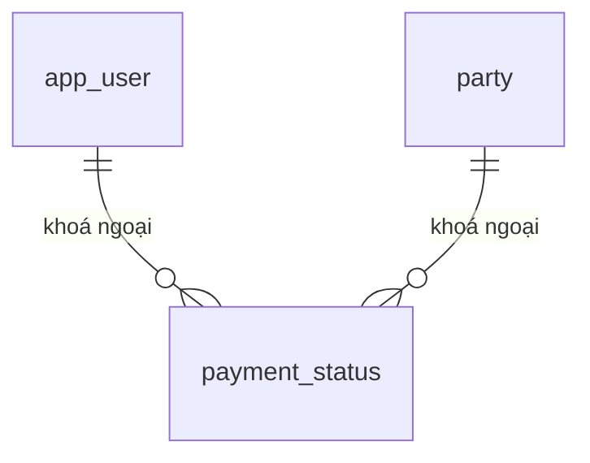

# PAYMENT_STATUS — Trạng thái thanh toán (`payment_status`)

> Biểu mẫu: **BM-2-901-50 v1.1** — Database Design · SUN ASTERISK VIETNAM CO., LTD · ISO/IEC 27001:2013 & ISO 9001:2015

---

## 1. Lịch sử sửa đổi

| No | Version | Action | Nội dung thay đổi | Ngày | Người sửa |
|---|---|---|---|---|---|
| 1 | 0.1.0 | Add New | Trích từ `supabase/01_schema.sql` của prototype LAB-3 | 2026-10-11 | nguyen-van-manh-c |

---

## 2. Danh sách bảng

| Mục | Giá trị |
|---|---|
| System Name | Hệ thống hỗ trợ vận hành chợ bán buôn thủy sản |
| Schema | `public` |
| Logical table name | Trạng thái thanh toán |
| Physics table name | `payment_status` |
| CHARACTER SET | UTF-8 |
| Overview | Trạng thái thanh toán |

---

## 3. ER Diagram

Quan hệ trực tiếp của `payment_status`. Sơ đồ toàn hệ thống ở [`_extra/database-overview.md`](../../../../_extra/database-overview.md).

---
## 4. Định nghĩa bảng

| No. | Key | Logical name | Physic name | Data Type | Not Null | Default | Ghi chú |
|---|---|---|---|---|---|---|---|
| 1 | PK | id | `id` | `uuid` | ✓ | `gen_random_uuid()` |  |
| 2 | FK | party_id | `party_id` | `uuid` | ✓ |  | → `party.id` |
| 3 |  | business_day | `business_day` | `date` | ✓ |  |  |
| 4 |  | due_date | `due_date` | `date` | ✓ |  |  |
| 5 | | Ngày thanh toán thực tế | `paid_date` | `date` |  |  | null = chưa thanh toán. Màn SCR-20 dùng cột này để xét đúng hạn: `paid_date <= due_date` |
| 6 | FK | entered_by | `entered_by` | `uuid` |  |  | → `app_user.id` |
| 7 |  | entered_at | `entered_at` | `timestamptz` | ✓ | `now()` |  |
| 8 |  | unique | `unique` | `(party_id, business_day)` |  |  |  |

---

### Ràng buộc và ghi chú

`paid_date` là cột quyết định việc có được thưởng hay không: `SCR_20_SPEC`, `INC_CALC_TECH` và ERD đều đọc cột này. Null nghĩa là **chưa thanh toán** → thưởng = 0, không phải lỗi dữ liệu.

Không có ràng buộc nghiệp vụ đặc biệt ngoài khoá ngoại và CHECK đã nêu ở mục 3.
