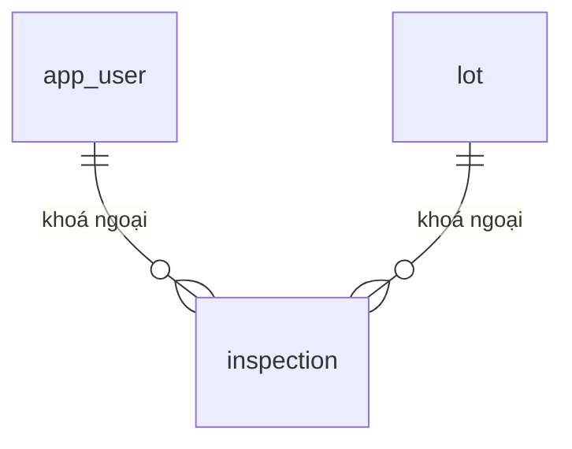

# INSPECTION — Kết quả thẩm định (`inspection`)

> Biểu mẫu: **BM-2-901-50 v1.1** — Database Design · SUN ASTERISK VIETNAM CO., LTD · ISO/IEC 27001:2013 & ISO 9001:2015

---

## 1. Lịch sử sửa đổi

| No | Version | Action | Nội dung thay đổi | Ngày | Người sửa |
|---|---|---|---|---|---|
| 1 | 0.1.0 | Add New | Trích từ `supabase/01_schema.sql` của prototype LAB-3 | 2026-10-11 | nguyen-van-manh-c |

---

## 2. Danh sách bảng

| Mục | Giá trị |
|---|---|
| System Name | Hệ thống hỗ trợ vận hành chợ bán buôn thủy sản |
| Schema | `public` |
| Logical table name | Kết quả thẩm định |
| Physics table name | `inspection` |
| CHARACTER SET | UTF-8 |
| Overview | Kết quả thẩm định |

---

## 3. ER Diagram

Quan hệ trực tiếp của `inspection`. Sơ đồ toàn hệ thống ở [`_extra/database-overview.md`](../../../../_extra/database-overview.md).

---
## 4. Định nghĩa bảng

| No. | Key | Logical name | Physic name | Data Type | Not Null | Default | Ghi chú |
|---|---|---|---|---|---|---|---|
| 1 | PK | id | `id` | `uuid` | ✓ | `gen_random_uuid()` |  |
| 2 | FK | lot_id | `lot_id` | `uuid` | ✓ |  | → `lot.id` |
| 3 |  | grade | `grade` | `text` | ✓ |  | CHECK grade in ('A','B','C') |
| 4 |  | note | `note` | `text` |  |  |  |
| 5 | FK | inspected_by | `inspected_by` | `uuid` | ✓ |  | → `app_user.id` |
| 6 |  | inspected_at | `inspected_at` | `timestamptz` | ✓ | `now()` |  |

---

### Ràng buộc và ghi chú

Cố tình **không có** cột điểm do máy tính ra. Hạng do người thẩm định chọn. Xem [ADR-007](../../../../_extra/decisions/ADR-007-giu-nguoi-trong-vong-lap.md).
