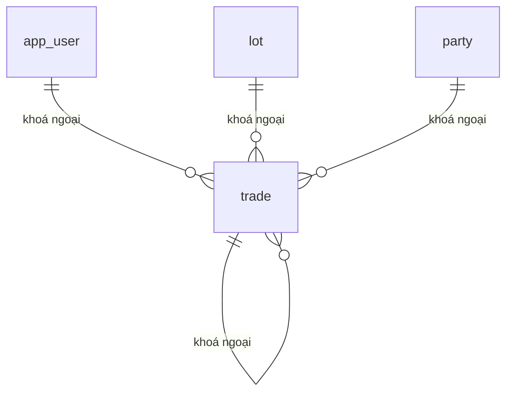

# TRADE — Giao dịch (`trade`)

> Biểu mẫu: **BM-2-901-50 v1.1** — Database Design · SUN ASTERISK VIETNAM CO., LTD · ISO/IEC 27001:2013 & ISO 9001:2015

---

## 1. Lịch sử sửa đổi

| No | Version | Action | Nội dung thay đổi | Ngày | Người sửa |
|---|---|---|---|---|---|
| 1 | 0.1.0 | Add New | Trích từ `supabase/01_schema.sql` của prototype LAB-3 | 2026-10-11 | nguyen-van-manh-c |

---

## 2. Danh sách bảng

| Mục | Giá trị |
|---|---|
| System Name | Hệ thống hỗ trợ vận hành chợ bán buôn thủy sản |
| Schema | `public` |
| Logical table name | Giao dịch |
| Physics table name | `trade` |
| CHARACTER SET | UTF-8 |
| Overview | Giao dịch |

---

## 3. ER Diagram

Quan hệ trực tiếp của `trade`. Sơ đồ toàn hệ thống ở [`_extra/database-overview.md`](../../../../_extra/database-overview.md).

---
## 4. Định nghĩa bảng

| No. | Key | Logical name | Physic name | Data Type | Not Null | Default | Ghi chú |
|---|---|---|---|---|---|---|---|
| 1 | PK | id | `id` | `uuid` | ✓ | `gen_random_uuid()` |  |
| 2 | UK | trade_code | `trade_code` | `text` | ✓ |  |  |
| 3 |  | business_day | `business_day` | `date` | ✓ |  |  |
| 4 |  | kind | `kind` | `trade_kind` | ✓ |  |  |
| 5 | FK | lot_id | `lot_id` | `uuid` | ✓ |  | → `lot.id` |
| 6 | FK | seller_id | `seller_id` | `uuid` | ✓ |  | → `party.id` |
| 7 | FK | buyer_id | `buyer_id` | `uuid` | ✓ |  | → `party.id` |
| 8 |  | quantity_kg | `quantity_kg` | `numeric(10,2)` | ✓ |  |  |
| 9 |  | unit_price | `unit_price` | `numeric(10,2)` | ✓ |  |  |
| 10 |  | amount | `amount` | `numeric(12,2)` | ✓ |  |  |
| 11 |  | hand_sign | `hand_sign` | `text` |  |  |  |
| 12 | FK | reverses_id | `reverses_id` | `uuid` |  |  | → `trade.id` |
| 13 | FK | created_by | `created_by` | `uuid` |  |  | → `app_user.id` |
| 14 |  | created_at | `created_at` | `timestamptz` | ✓ | `now()` |  |
| 15 | | Trạng thái xác nhận | `confirm_status` | `trade_confirm_status` | ✓ | `'confirmed'` | `pending_confirm` / `confirmed` / `rejected`. Giao dịch thỏa thuận mặc định `confirmed`; đấu giá bắt đầu ở `pending_confirm` |
| 16 | FK | Người xác nhận 確認者 | `confirmed_by` | `uuid` |  |  | → `app_user.id`. **Phải khác `created_by`** — người ghi không tự xác nhận |
| 17 | | Thời điểm xác nhận | `confirmed_at` | `timestamptz` |  |  | null khi chưa xác nhận |

---

### Ràng buộc và ghi chú

**Xác nhận kết quả đấu giá (ADR-009).** Dòng `kind = 'auction'` ghi vào với `confirm_status = 'pending_confirm'`, chưa có hiệu lực. Bảng đối soát và phép tính thưởng chỉ cộng dòng có `confirm_status = 'confirmed'`. Trigger `trade_confirm_check` chặn `confirmed_by = created_by`.

**Sổ ghi-thêm.** Trigger `trade_no_update` và `trade_no_delete` chặn mọi lệnh UPDATE/DELETE ở tầng database. Sửa giao dịch = thêm dòng mới có `reverses_id` trỏ về dòng gốc, `quantity_kg` và `amount` mang dấu âm. Xem [ADR-001](../../../../_extra/decisions/ADR-001-so-ghi-them.md).
